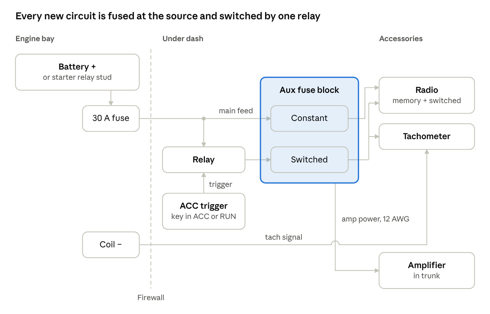

# 1966 Mustang Accessory Rewiring Guide

2026-10-26

## The plan

Run one fused main feed from the battery into an auxiliary fuse block under the dash and switch it with a relay triggered by the key. Every accessory then gets its own fuse, its own labeled wire, and a solid ground, and nothing piggybacks on 60-year-old factory circuits.

This fixes the three problems with the old setup:

- **The starter relay is not switched power.** The big battery stud on the fender-mounted starter relay is hot all the time; the small S and I terminals are hot only while cranking. Anything wired there either drains the battery or only works during cranking.
- **Splicing into factory circuits overloads them.** Every amp you add flows through the original ignition switch contacts and aging wire. The relay means the key only carries a tiny trigger current (about 0.15 A).
- **Unfused wire through the firewall is a fire risk.** A fuse protects the wire, so it must sit at the power source end. A chafed wire upstream of a fuse is a dead short to the body.

It's built for your setup: a retro-style head unit (constant memory feed plus switched feed), a small 2-channel amp (Phase Linear UPA224, 120 W peak), and an electronic-ignition tach.

*new accessory wiring · one fused feed, one relay, one fuse block*

The amp is small enough to run off a constant circuit on the fuse block, so it needs no separate feed from the battery. The radio, tach and relay all ground to one point under the dash; the amp grounds to the body right next to it.

## Circuit plan

Every wire below has a fuse at its power end, sized to protect that wire. Pick one wire color per role (red = constant, orange = switched, black = ground) and label both ends of every wire.

| Circuit | Power from | Fuse | Wire | Goes to |
|---|---|---|---|---|
| Main feed | Battery + (or starter relay battery stud) | 30 A, within 7 in of the source | 10 AWG red | Fuse block constant input + relay pin 30 |
| Relay trigger | ACC circuit under dash (hot in ACC and RUN only) | Existing factory fuse | 18 AWG | Relay pin 86 |
| Relay ground | Under-dash ground point | None | 18 AWG black | Relay pin 85 |
| Switched bus | Relay pin 87 | Protected by main fuse | 10 AWG orange, short | Fuse block switched input |
| Radio memory (yellow lead) | Constant bus | Per radio manual (often 10–15 A) | 14 AWG | Head unit yellow |
| Radio switched (red lead) | Switched bus | 5 A | 16 AWG | Head unit red |
| Radio illumination (orange lead, if present) | Dash light circuit | Existing factory fuse | 18 AWG | Head unit orange |
| Tach power | Switched bus | 3 A (or per tach manual) | 18 AWG | Tach 12V lead |
| Tach signal | Coil negative (−) terminal | None | 18 AWG | Tach signal lead |
| Tach light | Dash light circuit | Existing factory fuse | 18 AWG | Tach light lead |
| Amp power | Constant bus on the fuse block | 15 A | 12 AWG copper | Amp +12V terminal |
| Amp ground | Bare body metal next to the amp | None | 12 AWG, under 3 ft | Amp GND terminal |
| Amp turn-on | Head unit remote lead (usually blue/white) | Head unit's own | 18 AWG | Amp REM terminal |
| Ground point | Bare metal under the dash | None | 10 AWG black | Ground bus on the fuse block |

All grounds for the radio, tach and relay land on the one under-dash ground point. If your radio's manual lists different fuse values, follow the manual.

To pick a gauge for anything else, size the wire to the fuse: 18 AWG up to 5 A, 16 AWG to 10 A, 14 AWG to 15 A, 12 AWG to 20 A, 10 AWG to 30 A, 8 AWG to 40–50 A. Those hold for the short runs in a car.

## Parts and connectors

Buy copper wire rated for automotive use, and skip anything labeled CCA (copper-clad aluminum) — it carries less current and corrodes at the terminals. Measure your actual runs before buying wire; the lengths below are typical for a Mustang with the amp in the trunk.

**Power distribution**

| Item | What to look for | Qty |
|---|---|---|
| Auxiliary fuse block | 6–12 circuit blade (ATO/ATC) block with a cover and a ground bus. Either a split-bus block (separate constant and switched sections) or one with a built-in relay. Blue Sea Systems and Painless Performance both sell these. | 1 |
| Relay (skip if block has one built in) | 12 V, 30/40 A automotive relay (standard 4- or 5-pin) with a pre-wired socket | 1 |
| Main feed fuse holder | Sealed 30 A Maxi or MIDI fuse holder, or a manual-reset (Type III) circuit breaker | 1 |
| Spare blade fuses | 3, 5, 10, 15 A | a few each |

**Wire**

| Item | What to look for | Qty |
|---|---|---|
| Primary wire | GXL or TXL (cross-linked insulation, rated 125 °C, fine for the engine bay), stranded copper | 10 AWG red ~10 ft, 10 AWG orange ~3 ft, 10 AWG black ~3 ft, 14 AWG ~20 ft, 16 AWG ~10 ft, 18 AWG in 3–4 colors ~25 ft each |
| Amp power and ground | 12 AWG copper, red and black | ~20 ft red, ~3 ft black |
| RCA cables + turn-on wire | Twisted-pair RCAs; many amp kits include both | 1 set, length to reach the amp |

**Connectors and terminals**

| Item | Where it's used |
|---|---|
| Adhesive-lined heat-shrink butt connectors, 22–10 AWG assortment | Joining wires, connecting to the radio harness |
| Adhesive-lined heat-shrink ring terminals: #10, 1/4 in, 5/16 in, 3/8 in studs | Battery, starter relay, coil, grounds, fuse block studs. Measure each stud and match the ring to it. |
| Fully insulated nylon female spade terminals (0.250 in) | Relay pins if no socket, tach tabs, factory accessory tabs |
| 2-pin weatherproof connector (Weatherpack or Deutsch DT) | Optional: the tach signal wire at the firewall, so the dash side can be unplugged |
| Battery terminal with auxiliary studs | Only if you tap at the battery instead of the starter relay |

**Routing and protection**

| Item | Where it's used |
|---|---|
| Rubber firewall grommets sized to each bundle, or a sealed bulkhead pass-through | Every wire through metal |
| Split loom (1/4, 3/8, 1/2 in) or braided sleeve | All engine-bay runs and anything near the floor |
| Adhesive-lined heat-shrink tubing (3:1) | Sealing splices and lug barrels |
| Cloth harness tape | Wrapping bundles under the dash (quieter than vinyl, won't go gooey) |
| Cushioned P-clamps and zip ties | Securing runs every 12–18 in |
| Star (internal-tooth) washers, bolts or self-tapping screws | Ground points |
| Wire labels (printable heat-shrink or label tape) | Both ends of every wire |

## Shopping list

The lean list comes to about $194 in parts, plus $76 in tools if you own none of them: $270 total, down from $622 for the first Summit cart. Everything is on Amazon, so it's one cart with Prime shipping. Prices were checked on 2026-10-29 and change often.

Most of the savings come from buying less, not from Amazon being cheaper. The Painless kit costs $89.99 at both stores. Real copper wire costs about the same everywhere.

**Parts**

| Item | Price | What it's for |
|---|---|---|
| [Painless CirKit Boss 70107 fuse block kit](https://www.amazon.com/dp/B000A8OG2A) | $89.99 | Fuse block, relay, breaker, feed and trigger wires, plus a wire already attached to each circuit |
| [12 gauge pure copper wire, red and black pair, 25 ft](https://www.amazon.com/dp/B0DGL723WB) | $27.99 | Amp power (red); amp and radio grounds (black). The two wires pull apart. |
| [TICONN 120-piece heat shrink terminal kit](https://www.amazon.com/dp/B086Z2Y1D6) | $9.99 | Rings, forks, spades, disconnects and butt connectors, 22–10 gauge |
| [18 gauge GXL wire, black and red, 25 ft each](https://www.amazon.com/dp/B094H8SKTC) | $26.38 | Tach signal and ground, dash light feeds, amp turn-on |
| [150-piece ATC blade fuse assortment](https://www.amazon.com/dp/B07VWRK2VD) | $8.99 | The tach, radio and 15 A amp fuses for the block |
| [200-piece rubber grommet kit](https://www.amazon.com/dp/B0F8N9PLXT) | $8.99 | Firewall pass-throughs, plugging old holes |
| [Boao braided split sleeve, 1/4, 1/2 and 3/4 in., 10 ft each](https://www.amazon.com/dp/B08JPV4NRJ) | $21.99 | Engine-bay runs; rated to 257 °F |
| Optional: [tesa 51036 cloth harness tape](https://www.amazon.com/dp/B016ZMXLEI) | $7.49 | Neater under-dash bundles; zip ties also work |

Still needed and not listed: RCA cables from the head unit to the amp. Get them wherever you bought the amp.

**Tools (skip any you already own)**

| Item | Price | Note |
|---|---|---|
| [iCrimp ratcheting crimper, 22–10 gauge](https://www.amazon.com/dp/B07Q4MG4BW) | $18.59 | For the heat-shrink terminals |
| [SEEKONE heat gun](https://www.amazon.com/dp/B086WH19WH) | $18.99 |  |
| [AstroAI digital multimeter](https://www.amazon.com/dp/B01ISAMUA6) | $14.99 | Also does the test light's job |
| [Klein 11061 self-adjusting wire stripper](https://www.amazon.com/dp/B00CXKOEQ6) | $22.96 | Optional if you have any decent stripper |

**What changed from the first cart**

- **Wire:** six full spools became two. The Painless kit already has a wire attached to every circuit, so you only need wire for the amp, a few grounds, the tach signal, the dash light feeds and the amp turn-on.
- **Terminals:** the $80 Summit kit is overkill for about 30 connections. A $10 kit covers it.
- **Heat shrink tubing:** dropped. The terminals and lugs already come with their own.
- **Loom:** two Holley nylon looms ($49) became one braided sleeve kit. The amp wire under the carpet doesn't need loom; only the engine-bay runs do. Skip the cheap polyethylene loom on Amazon, which is only rated to 149 °F.
- **Tools:** cheaper equivalents. The test light is dropped because the multimeter can find the ACC circuit too.
- **Kept on purpose:** the Painless kit. You could build the same thing for about $25 less, with a Blue Sea split-bus block, a relay and a breaker, but that means more connections and more of your time. The no-name $20–27 relay boxes on Amazon have mixed reviews. Painless also makes a 3-circuit version (70103) with enough circuits now that the socket is gone, but it costs more, at $102 on Amazon.

## Tools

The ratcheting crimper matters most: the cheap stamped crimp-and-strip pliers are the main reason home-made connections fail.

- Ratcheting crimper with dies for insulated terminals (red/blue/yellow)
- Self-adjusting wire stripper
- Heat gun (a lighter scorches the heat-shrink and the wire)
- Digital multimeter
- 12V test light
- Drill, step bit, and a round file for deburring any new hole
- Wire labeler or marker
- Optional: soldering iron for lugs, if you prefer soldering them

## Making good connections

A proper crimp with the right tool, sealed with adhesive heat-shrink, is the standard for a car: it holds up to vibration better than a bare solder joint. Every connection should pass a firm tug test.

**Crimping an insulated terminal or butt connector**

1. Match the terminal color to the wire: red for 22–18 AWG, blue for 16–14 AWG, yellow for 12–10 AWG.
2. Strip only enough to fill the metal barrel, usually 1/4 to 5/16 in. No bare copper should show past the barrel, and no insulation should be inside it.
3. Twist the strands lightly so none stray, then push the wire in until it bottoms out or shows just through the far end of a ring terminal barrel.
4. Crimp in the matching color die until the ratchet releases. For heat-shrink terminals, crimp on the barrel, not on the seam.
5. Tug hard. If it moves, cut it off and redo it.
6. Shrink the sleeve with the heat gun, working from the middle out, until a little clear adhesive squeezes out the ends.

**Splicing into an existing wire (the ACC trigger)**

Cut the wire, strip both ends, and twist the new wire together with one of the cut ends. Put that pair into one side of a butt connector sized for the two together, and the other cut end into the other side. Alternatively, strip a 1/2 in window, wrap the new wire around it, solder it, and cover it with adhesive heat-shrink slid on beforehand.

**Ring terminals on studs**

Use a ring sized to the stud (a loose ring on a big stud makes a poor contact). Stack rings flat, put the highest-current one closest to the stud base, and use a lock washer under the nut. Don't sandwich rings under a battery clamp bolt; use a terminal with auxiliary studs instead.

**Ground connections**

Grind or sand to bare, shiny metal about the size of a quarter. Bolt the ring down with a star washer between the ring and the body, then paint over the finished joint (or coat it with dielectric grease) to keep rust out. Don't use seat-belt anchor bolts.

**What to avoid**

- Snap-on "vampire" taps (Scotchlok, T-taps): they cut strands and loosen with vibration
- Twist-and-tape splices, or wire nuts
- Solid-core household wire, or speaker wire as power wire
- Any wire through a metal hole without a grommet
- Un-fused power wire, or a fuse at the wrong end of the wire

## Step-by-step install

Work in this order: find your trigger source, disconnect the battery, repair the old damage, build the distribution, then add one accessory at a time. Leave both main fuses out until testing.

**1. Find the ACC trigger source (battery connected)**

1. Under the dash, use a test light to find a circuit that is hot in ACC and RUN and dead in OFF. The circuit that fed the original radio is usually it, either at the ignition switch ACC terminal or the ACC side of the fuse panel.
2. Confirm it at every key position, then mark it with tape. Don't trust wire colors on a 60-year-old car.
3. Never use the coil feed. In RUN it passes through a resistor wire at reduced voltage.

**2. Disconnect and repair**

1. Disconnect the battery negative cable and tuck it away from the post.
2. Inspect every factory wire you tapped into in high school. Cut out any section nicked by tap connectors or with burnt or brittle insulation, and butt-splice in new wire of the same gauge.
3. Remove leftover connectors, tape and orphaned wire.
4. Seal unused holes from the old firewall runs with rubber grommet plugs or body plugs.
5. Clean and tighten the factory grounds: battery negative to the engine, and the engine-to-body strap. Add a 10 AWG strap from the engine to the firewall if there isn't one; old cars often have weak grounds that cause dim lights and gauge trouble.

**3. Mount the fuse block and relay**

1. Pick a spot under the dash you can reach to swap fuses, clear of the steering column, pedals, heater box, and any coolant drip path. The underside of the dash near the passenger kick panel usually works.
2. Screw the block and relay to the dash support or a small mounting plate, not to anything that moves.
3. Run 10 AWG black from the block's ground bus to a prepared bare-metal ground point nearby.

**4. Run the main feed**

1. Choose the firewall pass-through. Use an unused factory grommet if there is one. Otherwise drill in a flat spot after checking both sides for brake lines, the heater box and the factory harness, deburr the hole, and fit a rubber grommet.
2. Route 10 AWG red from the fuse block's constant input, through the grommet, to the power source. The starter relay's battery stud keeps the battery top tidy; a battery terminal with auxiliary studs also works.
3. Mount the 30 A fuse holder within 7 in of the source. Crimp a ring terminal sized to the stud for the short lead from the holder to the source.
4. Leave the fuse out.

**5. Wire the relay**

Relay pins are standard: 30 and 87 are the switched contacts, 85 and 86 are the coil.

1. Pin 30: short 10 AWG jumper from the constant input of the block.
2. Pin 87: short 10 AWG orange to the switched input of the block.
3. Pin 85: 18 AWG to the ground point.
4. Pin 86: 18 AWG to the ACC circuit you marked in step 1, spliced as described in Making good connections, or onto a spare factory accessory tab with a female spade.

If your block has a built-in relay, follow its instructions instead; it will have a terminal for the trigger wire.

**6. Radio**

1. Connect to the head unit's own harness with butt connectors, not to the radio itself.
2. Yellow (memory) to its constant-bus fuse, red to the 5 A switched fuse, black to the ground point.
3. Orange (illumination), if present, to the dash light circuit, which is the feed for the instrument lights that changes with the headlight-switch dimmer.
4. Blue/white (remote) goes to the amp turn-on in step 9.
5. Check the radio's manual for its exact colors and fuse values.

**7. Tachometer**

1. Power lead to the 3 A switched fuse, ground lead to the ground point, light lead to the dash light circuit.
2. Run the signal wire through a firewall grommet to the coil negative (−) terminal, the side that goes to the distributor. Use a ring terminal stacked under the existing nut.
3. Route the signal wire away from the spark plug wires, which can cause a jumpy needle.
4. Set the tach's cylinder selector to match your engine.
5. With an electronic conversion like a Pertronix Ignitor, coil negative is the correct signal point for most tachs. If the needle is erratic, check both the tach's and the ignition maker's notes.
6. Don't power the tach from the coil positive terminal; that's the reduced-voltage resistor-wire feed.

**8****. Amplifier**

1. Run 12 AWG red from one of the fuse block's constant-hot circuits, fused at 15 A, down one side of the car under the door sill plates and carpet to the amp. It stays inside the car, so it needs no extra firewall hole.
2. Run the RCA cables and the turn-on wire down the other side, or down the center tunnel. Power and signal running together cause whine; if they must cross, cross at 90°.
3. Mount the amp to a board or bracket where it gets air, not loose on the trunk floor or under carpet.
4. Ground the amp with under 3 ft of 12 AWG black to a prepared bare-metal spot on the trunk floor or a body brace. Seal any hole you drill.
5. The amp has a screw terminal strip. Crimp yellow (12–10 gauge) ring or fork terminals onto the power and ground wires, and a red (22–18 gauge) one onto the turn-on wire.
6. Connect the turn-on wire to the head unit's blue/white remote lead.
7. Leave the amp's own fuse in place. The 15 A fuse in the block protects the wire; the amp's fuse protects the amp.

**9****. Route and secure everything**

1. Loom every engine-bay run. Keep it at least several inches from the exhaust manifolds and away from the fan, belts, throttle linkage and steering shaft.
2. Under the dash, bundle wires with cloth tape and keep them clear of the pedals, steering column and parking brake.
3. Clamp or tie every 12–18 in, and leave a little slack at each end so nothing is under tension.
4. Add a small drip loop just before each firewall grommet so water runs off instead of following the wire through.
5. Label both ends of every wire, and write a one-page wiring map to keep in the glovebox.

## Testing

Power up in stages so a mistake blows a fuse instead of melting a wire.

**Before connecting the battery**

1. Pull every fuse from the new block. Both main fuses are still out.
2. Set the multimeter to resistance and measure from the load side of each main fuse holder to bare metal. It should read open (OL). A reading near 0 Ω means a short; find it before going further.

**First power-up**

1. Reconnect the battery negative and install the 30 A main fuse, block fuses still out.
2. Constant bus: about 12.6 V with the key off.
3. Switched bus: 0 V in OFF, battery voltage in ACC and RUN, with an audible relay click.
4. Add the block fuses one at a time and check each accessory:
   1. Radio turns on with the key, and keeps a preset after the key goes off and on again.
   2. Tach lights with the dash lights, and reads a sensible idle with the engine running; compare against a timing light or handheld tach if you have one.
5. Install the amp's 15 A fuse in the block. The amp should power on with the radio and off with the key.
6. Set the amp gain per its manual, with the radio at about three-quarters volume, rather than turning it all the way up.

**Voltage drop**

With the amp playing loud and the engine running, measure from battery positive to the amp's +12V terminal, then from the amp's ground terminal to battery negative. Each should be under about 0.5 V. More than that points to a bad crimp, an undersized wire, or a poor ground.

**Key-off drain**

1. With everything off, put the meter in series with the battery negative cable on the 10 A range first, then step down.
2. A car this age with no computers should draw almost nothing; a radio's memory adds a few milliamps up to about 30 mA.
3. Anything above about 50 mA means something is staying on. Pull fuses one at a time until the reading drops.
4. Don't crank the engine or switch on the headlights with the meter in line.

**After a week of driving**

Recheck every nut and ground bolt. After a long drive, carefully feel each connection; a joint that's noticeably warm has high resistance and should be redone.
